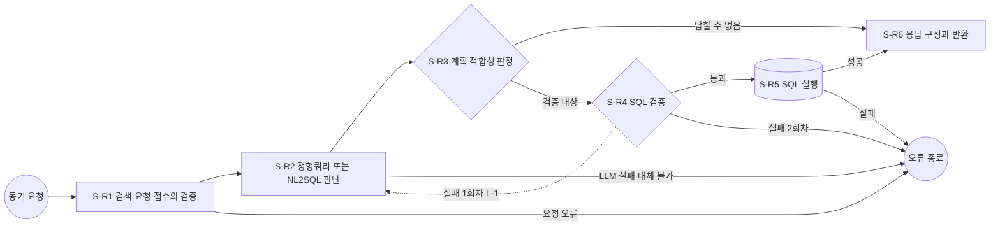

# SQL 검색기 워크플로우 설계서 (PPT 스크립트)

- 문서 성격: PPT 빌드 전에 쓰는 슬라이드 단위 스크립트. 슬라이드마다 패턴, 리드문, 본문, 도형을 적음  
- 근거 자료: `references/design-workflow-connector.md`(표 항목, 계산식, ID 규칙), `references/pptx-guide.md`,  
  `references/prompt-guide.md`, `work/db_catalog.json`(DB 구조), `work/decisions.json`(설계 결정)
- 레이아웃: 모든 슬라이드 `내용_단쪽`. 글꼴 Pretendard. 장 제목은 제목 개체 틀에 넣음  
- 작성: design-agentic-ai 팀 지식니(지식, 데이터 엔지니어). 단계 흐름과 시간 예산은 플로니 관점,  
  커넥터 명세는 커넥니 관점으로 한 번 더 점검함
- 작성일: 2026-10-15
- 3조 반영(2026-10-19): VIP 이탈 방지용 논리 뷰 5개(`rdb/init/07_vip_churn_views.sql`)와 정형쿼리 `FQ-10` ~ `FQ-14`를 더함.  
  DB를 실행하지 못해 새 뷰와 정형쿼리의 EXPLAIN, 접근 권한 실측은 하지 않았음(팀원 PC에서 확인 필요)

---

## 슬라이드 1. SQL 검색기 워크플로우 설계서

- 패턴: 제목 장표(예외 규칙: `내용_단쪽` 레이아웃, 설계서 제목은 제목 개체 틀)
- 리드문: 없음
- 본문
  - 워크플로우: `W-1` SQL 검색기
  - 부제: 상담사 질문을 정형쿼리 또는 NL2SQL로 바꿔 카드 회원 DB에서 안전하게 답을 찾는 동기 요청 워크플로우
  - 팀명: 3조(기반 설계: design-agentic-ai 예제) / 작성일: 2026-10-19
- 도형: 가운데 네이비 넘버 배지 `W-1`, 아래 틴트 박스에 부제, 하단 필 라벨 2개(팀명, 작성일)

---

## 슬라이드 2. 설계 개요

- 패턴: A (좌: 네이비 헤더 바 `설계 대상과 범위`, 우: 블루 헤더 바 `핵심 결정값`)
- 리드문: 상담사가 기다리는 30초 안에, 허용된 뷰만 읽기 전용으로 조회하는 검색기를 설계함
- 본문(좌, 틴트 박스)
  - 설계 대상: `W-1` SQL 검색기(질문 → 정형쿼리 또는 NL2SQL → 결과 행 반환)
  - 관련 유저스토리: 없음
  - 시작 트리거: 동기 요청(호출자가 검색을 요청하고 응답을 기다림) → 단계ID 접두어 `S-R`
  - 설계 범위: 요청 검증, 경로 판단, 계획 판정, SQL 검증, SQL 실행, 응답 반환, Groq LLM 커넥터
  - 제외 범위: 답변 문장 작성(호출자 몫), 기존 뷰와 RLS의 변경(3조는 이탈 신호용 뷰 5개를 추가만 함), 화면, 배포
  - DB 취급: 시스템 내부 구성요소(사용자 결정). 외부시스템 연동과 커넥터 목록에서 제외
- 본문(우, 넘버 배지 리스트)
  1. 전체 시간 예산 30초, 종료 처리 시간 1초
  2. LLM: Groq `openai/gpt-oss-120b`, 타임아웃 12초, 재시도 0회
  3. SQL 검증 실패 시 다시 만들기 1회(반복 구간 `L-1`)
  4. 실행 계정 `sql_retriever_user`, 허용 뷰 12개(기본 7개 + 3조 추가 5개), 결과 행 상한 200
  5. 필드 표기: `이름(타입, 필수 여부, 설명)`. 타입은 str, int, bool, date, list, obj
- 도형: 좌우 2단 헤더 바, 우측 넘버 스퀘어 배지 1 ~ 5

## 슬라이드 3. 설계 개요: 처음 보는 분을 위한 용어 풀이

- 패턴: D (표 1개, 우측 틴트 박스에 읽는 순서)
- 리드문: NL2SQL을 처음 접하는 검토자도 이 설계서를 읽을 수 있도록 용어를 한 줄씩 풀이함
- 본문(표: 용어 | 한 줄 풀이)
  - NL2SQL | 사람의 말(자연어) 질문을 LLM이 SQL로 바꾸는 방식
  - 정형쿼리 | 자주 묻는 조회를 미리 만들어 검증해 둔 고정 SQL. LLM은 ID만 고름
  - 뷰(View) | 원본 테이블에서 필요한 컬럼과 기간만 골라 보여 주는 가상 테이블
  - 행 수준 보안(RLS) | 같은 테이블이라도 세션에 지정한 회원의 행만 보이게 하는 DB 규칙
  - 세션 변수 | 한 트랜잭션 동안만 DB에 알려 주는 값. 여기서는 회원ID, 기준일, 거래 제공 시작일
  - 최악값 | 한 연동이 가장 오래 걸릴 때의 시간. `타임아웃 × (1 + 재시도 횟수)`
  - 남은 시간 예산 | 단계를 시작하기 전에 앞으로 쓸 수 있는 시간을 다시 재는 값
  - 착지 단계 | 시간이나 재시도를 다 썼을 때 이어서 가는 안전한 단계
- 우측 틴트 박스: 읽는 순서 ① 흐름 → ② 단계 → ③ 연동 → ④ 반복 → ⑤ 합계 → 커넥터 → ⑥ 실행 중 시간 관리

---

## 슬라이드 4. 목차

- 패턴: E (목차, 번호 + 하위 항목 3열)
- 리드문: 설계 가이드의 작성 순서 ① ~ ⑥에 커넥터 설계와 부록을 더해 구성함
- 본문(3열 카드)
  - 열 1 흐름: ① 단계 도출 및 순서 정의(단계 목록, 흐름 도식, Mermaid) / ② 단계별 명세(`S-R1` ~ `S-R6`)
  - 열 2 시간: ③ 외부시스템 연동 명세 / ④ 반복 구간 명세 / ⑤ 워크플로우 명세 / ⑥ 남은 시간 예산 정책
  - 열 3 연결과 부록: 커넥터 설계(목록, LLM 명세, 프롬프트, 응답 구조) / 부록(뷰와 정형쿼리, SQL 검증 규칙,
    필드 영문명, 오류 응답, 설계 점검표, 설계 가정과 위험 항목)
- 도형: 넘버 배지 1 ~ 3이 붙은 틴트 카드 3개

<!-- 간지: ① 단계 도출 및 순서 정의 -->

---

## 슬라이드 5. ① 단계 도출 및 순서 정의: 단계 목록과 흐름 유형

- 패턴: D (좌: 단계 목록 표, 우: 흐름 유형 판단)
- 리드문: 입력 워크플로우의 6단계를 그대로 쓰고, 분기 2곳과 반복 1곳을 둠
- 본문(좌 표: 단계ID | 단계명 | 담당자 유형)
  - `S-R1` | 검색 요청 접수와 검증 | 규칙기반 코드
  - `S-R2` | 정형쿼리 또는 NL2SQL 판단 | 생성형AI + 규칙기반 코드
  - `S-R3` | 계획 적합성 판정 | 규칙기반 코드
  - `S-R4` | SQL 검증 | 규칙기반 코드
  - `S-R5` | SQL 실행 | 규칙기반 코드
  - `S-R6` | 응답 구성과 반환 | 규칙기반 코드
- 본문(우 표: 흐름 유형 | 위치 | 판단 이유)
  - 순차 | `S-R1` → `S-R2` → `S-R3` → `S-R4` → `S-R5` → `S-R6` | 앞 단계 출력이 뒤 단계 입력임
  - 분기 | `S-R3` | 계획이 "답할 수 없음"이면 SQL 없이 `S-R6`로 감
  - 분기 | `S-R4` | 통과는 `S-R5`, 실패는 다시 만들기 또는 오류 종료
  - 반복 | `L-1`(`S-R2` ~ `S-R4`) | 검증 실패 사유를 주고 SQL을 1회 다시 만듦
  - 병렬 | 없음 | 모든 단계가 바로 앞 단계 출력을 써서 동시에 돌릴 단계가 없음
- 도형: 좌우 2개 표, 각 표 위 다크 배지(`단계 목록`, `흐름 유형`)

## 슬라이드 6. ① 단계 도출 및 순서 정의: 흐름 도식

- 패턴: 도식(전폭)
- 리드문: LLM은 경로 판단 한 곳에서만 쓰고, SQL은 검증을 통과해야만 DB로 감
- 본문(도식, PowerPoint 도형으로 그림)
  - 시작: 원 `동기 요청` → 상자 `S-R1 검색 요청 접수와 검증`
  - `S-R1` → 상자 `S-R2 정형쿼리 또는 NL2SQL 판단`(LLM 단계 색)
  - `S-R2` → 마름모 `S-R3 계획 적합성 판정`
  - `S-R3` -- 답할 수 없음 --> `S-R6`
  - `S-R3` -- 검증 대상 --> 마름모 `S-R4 SQL 검증`
  - `S-R4` -- 통과 --> 상자 `S-R5 SQL 실행`(DB 조회 색)
  - `S-R4` -- 실패, 1회차 --> `S-R2`(되돌아가는 점선 화살표, `L-1` 표시)
  - `S-R4` -- 실패, 2회차 --> 원 `오류 종료`
  - `S-R5` -- 성공 --> 상자 `S-R6 응답 구성과 반환`
  - `S-R5` -- 실패 --> `오류 종료`
  - `S-R1` -- 요청 오류 --> `오류 종료`, `S-R2` -- LLM 실패와 대체 경로 불일치 --> `오류 종료`
- 범례: LLM 단계(블루 채움), 규칙기반 단계(흰 상자, 네이비 테두리), 판정(마름모), DB 조회(틴트 채움 + 굵은 테두리),
  오류 종료(다크 슬레이트 원), 반복(점선)
- 각주: 모든 단계는 시작 전에 ⑥ 남은 시간 예산을 확인하고, 미달이면 표의 착지 단계로 감

## 슬라이드 7. ① 단계 도출 및 순서 정의: Mermaid 도식 스크립트

- 패턴: D (좌: 코드 박스, 우: 보는 방법)
- 리드문: 같은 흐름을 Mermaid 스크립트로도 남겨 누구나 다시 그릴 수 있게 함
- 본문(좌, 코드 박스)



- 본문(우, 틴트 박스): 보는 방법 mermaid.live/edit 접속 → 왼쪽에 붙여 넣기 → 오른쪽 위 전체보기

<!-- 간지: ② 단계별 명세 -->

---

## 슬라이드 8. ② 단계별 명세: S-R1 검색 요청 접수와 검증

- 패턴: D (11개 항목 표, 좌 6개 항목 + 우 5개 항목)
- 리드문: 잘못된 요청과 개인 식별자는 첫 단계에서 걸러, 외부 LLM에 가는 글을 최소로 만듦

| 항목 | 내용 |
|------|------|
| 단계ID | `S-R1` |
| 단계명 | 검색 요청 접수와 검증 |
| 이전 단계 | 트리거(동기 요청) |
| 비즈니스 목표 | 형식이 맞고 실제로 있는 회원의 질문만 받아, 개인 식별자를 가린 질문으로 바꿈 |
| 입력 데이터 | `request_id`(str, 선택, 호출자 추적 ID) / `member_id`(str, 필수, 상담 대상 회원ID) /  `question`(str, 필수, 상담사 질문 1 ~ 500자) / `base_date`(date, 선택, 조회 기준일) |
| 수행 작업 | 1. 필수 값과 형식 확인(`member_id`는 `M-` + 숫자 4자리) 2. 읽기 전용 트랜잭션에서 `public.lab_metadata`의 `base_date`, `txn_period`를 읽어 기준일과 거래 제공 시작일 결정 3. 세션 변수 3개 지정 후 `app_internal.member_basic`으로 회원과 가입일 확인(`statement_timeout` ≤ 남은 시간 예산) 4. 질문의 회원ID, 카드번호, 전화번호, 주민등록번호, 이메일을 규칙(정규식)으로 가림 |
| 출력 데이터 | `request_id`(str, 필수, 없으면 생성) / `member_id`(str, 필수, 내부 전용) / `masked_question`(str, 필수, 가린 질문) / `masked_types`(list, 필수, 가린 종류) / `base_date`(date, 필수) / `coverage_start`(date, 필수, 거래 제공 시작일) / `started_at`(float, 필수, 시작 시각) / `attempt`(int, 필수, 1) |
| 담당자 유형 | 규칙기반 코드 |
| 외부시스템 | 없음(시스템 내부 DB) |
| 예외 처리 | 형식 오류 → `INVALID_REQUEST`(400) / 회원 없음 또는 기준일에 가입 전 → `MEMBER_NOT_FOUND`(404) / DB 접속 실패 → `DB_UNAVAILABLE`(503) |
| 비고 | 회원ID는 LLM에 보내지 않고 세션 변수로만 씀. 이름은 정규식으로 못 가려 위험 항목으로 둠 |

- 도형: 2단 표(좌: 단계ID, 단계명, 이전 단계, 비즈니스 목표, 담당자 유형, 외부시스템 / 우: 입력, 수행 작업,
  출력, 예외 처리, 비고), 항목명 셀은 다크 배지 색

## 슬라이드 9. ② 단계별 명세: S-R2 정형쿼리 또는 NL2SQL 판단

- 패턴: D (11개 항목 2단 표)
- 리드문: LLM을 한 번만 불러 경로와 SQL 초안을 함께 받고, 실패하면 키워드 규칙으로 대신함

| 항목 | 내용 |
|------|------|
| 단계ID | `S-R2` |
| 단계명 | 정형쿼리 또는 NL2SQL 판단 |
| 이전 단계 | `S-R1` 검색 요청 접수와 검증, `S-R4` SQL 검증(검증 실패로 되돌아올 때) |
| 비즈니스 목표 | 질문에 맞는 조회 방법을 골라, 정형쿼리가 없을 때만 LLM이 SQL을 만들게 함 |
| 입력 데이터 | `masked_question`(str, 필수, `S-R1`) / `base_date`, `coverage_start`(date, 필수, `S-R1`) / `attempt`(int, 필수, `S-R1` 또는 `S-R4`) / `validation_errors`(list, 선택, `S-R4`) / `previous_sql`(str, 선택, `S-R4`) |
| 수행 작업 | 1. 남은 시간 예산 확인 2. 프롬프트 조립(정형쿼리 목록, 허용 뷰와 컬럼, 기간, 검증 실패 사유) 3. `C-01` 호출(타임아웃 12초, 재시도 0회, JSON 스키마 엄격 모드) 4. 응답이 스키마와 맞는지 확인 5. 호출 실패 시 정형쿼리 키워드 표로 규칙 매칭(대체 경로) |
| 출력 데이터 | `route`(str, 필수, fixed 또는 nl2sql 또는 unanswerable) / `fixed_query_id`(str, 선택) / `generated_sql`(str, 선택) / `used_views`(list, 필수) / `reason`(str, 필수, 판단 근거) / `plan_source`(str, 필수, llm 또는 keyword_fallback) / `attempt`(int, 필수) |
| 담당자 유형 | 생성형AI + 규칙기반 코드(대체 경로) |
| 외부시스템 | Groq LLM(`C-01`) |
| 예외 처리 | 시간 초과, 429, 5xx, 스키마 불일치 → 키워드 매칭. 일치 없음 → `LLM_UNAVAILABLE`(503) |
| 비고 | LLM에는 가린 질문과 뷰 구조만 보냄. 회원ID와 결과 행은 보내지 않음 |

- 도형: 2단 표, `외부시스템` 칸에 블루 필 라벨 `C-01`

## 슬라이드 10. ② 단계별 명세: S-R3 계획 적합성 판정

- 패턴: D (11개 항목 2단 표)
- 리드문: LLM이 낸 계획을 그대로 믿지 않고, 경로와 내용이 서로 맞는지 규칙으로 판정함

| 항목 | 내용 |
|------|------|
| 단계ID | `S-R3` |
| 단계명 | 계획 적합성 판정 |
| 이전 단계 | `S-R2` 정형쿼리 또는 NL2SQL 판단 |
| 비즈니스 목표 | 답할 수 없는 질문은 SQL 없이 돌려보내고, 나머지는 검증할 SQL 한 개로 정리함 |
| 입력 데이터 | `route`, `fixed_query_id`, `generated_sql`, `used_views`, `reason`, `plan_source`, `attempt`(모두 `S-R2`) |
| 수행 작업 | 1. 남은 시간 예산 확인 2. `route` 값 확인 3. fixed: `fixed_query_id`가 `FQ-01` ~ `FQ-14`에 있으면 그 SQL을 후보로 4. nl2sql: SQL이 비어 있지 않고 `used_views`가 허용 뷰 안이면 후보로 5. unanswerable: `S-R6`로 보냄 6. 경로와 값이 어긋나면 `plan_issues`에 적어 `S-R4`에서 실패 처리 |
| 출력 데이터 | `decision`(str, 필수, to_validate 또는 unanswerable) / `candidate_sql`(str, 선택) / `plan_issues`(list, 필수) / `route`(str, 필수) / `fixed_query_id`(str, 선택) / `unanswerable_reason`(str, 선택) / `attempt`(int, 필수) |
| 담당자 유형 | 규칙기반 코드 |
| 외부시스템 | 없음 |
| 예외 처리 | 남은 시간 예산 미달 → `BUDGET_EXCEEDED`(504) |
| 비고 | "답할 수 없음"은 오류가 아니라 정상 응답(status unanswerable)임 |

- 도형: 2단 표, `decision` 값 2개를 필 라벨로 표시

## 슬라이드 11. ② 단계별 명세: S-R4 SQL 검증

- 패턴: D (11개 항목 2단 표)
- 리드문: LLM이 만든 SQL은 허용 범위를 검사하기 전에는 절대 실행하지 않음

| 항목 | 내용 |
|------|------|
| 단계ID | `S-R4` |
| 단계명 | SQL 검증 |
| 이전 단계 | `S-R3` 계획 적합성 판정 |
| 비즈니스 목표 | 허용된 뷰와 구문만 쓰는 읽기 SQL만 실행 단계로 넘겨 데이터 유출과 DB 부하를 막음 |
| 입력 데이터 | `candidate_sql`(str, 선택, `S-R3`) / `plan_issues`(list, 필수, `S-R3`) / `route`, `fixed_query_id`, `attempt`(`S-R3`) |
| 수행 작업 | 1. 남은 시간 예산 확인 2. `plan_issues`가 있으면 실패 3. 구문 분석으로 SELECT 1문장인지 확인 4. 금지 구문, 주석, 여러 문장 확인 5. 뷰, 컬럼, 함수가 허용 목록 안인지 확인 6. LIMIT을 201(상한 200 + 잘림 확인 1)로 강제 7. 읽기 전용 트랜잭션에서 `EXPLAIN`으로 문법과 권한 확인 |
| 출력 데이터 | `validated_sql`(str, 선택) / `row_limit`(int, 필수, 200) / `validation_errors`(list, 필수) / `previous_sql`(str, 선택) / `attempt`(int, 필수, 되돌아갈 때 2) / `route`, `fixed_query_id` |
| 담당자 유형 | 규칙기반 코드 |
| 외부시스템 | 없음(시스템 내부 DB) |
| 예외 처리 | 실패 1회차 → `S-R2`로 되돌아감(`L-1`) / 실패 2회차 → `SQL_VALIDATION_FAILED`(422) 오류 종료 |
| 비고 | 실패 사유는 LLM에만 돌려주는 내부 정보. 호출자 오류 메시지에 SQL, 뷰 이름을 넣지 않음 |

- 도형: 2단 표, 실패 경로 2개를 다크 배지로 강조

## 슬라이드 12. ② 단계별 명세: S-R5 SQL 실행

- 패턴: D (11개 항목 2단 표)
- 리드문: 세션 변수로 회원 범위를 정한 읽기 전용 트랜잭션에서, 남은 시간 안에서만 SQL을 실행함

| 항목 | 내용 |
|------|------|
| 단계ID | `S-R5` |
| 단계명 | SQL 실행 |
| 이전 단계 | `S-R4` SQL 검증 |
| 비즈니스 목표 | 검증된 SQL을 이 회원의 데이터 범위 안에서만 실행해 답의 근거 데이터를 얻음 |
| 입력 데이터 | `validated_sql`, `row_limit`, `route`, `fixed_query_id`(`S-R4`) / `member_id`, `base_date`, `coverage_start`(`S-R1`) |
| 수행 작업 | 1. 남은 시간 예산 측정 2. `sql_retriever_user`로 연결 3. `BEGIN READ ONLY` 4. `set_config`로 `app.member_id`, `app.base_date`, `app.coverage_start` 지정(트랜잭션 한정) 5. `SET LOCAL statement_timeout` = min(남은 시간 예산, 5초) 6. SQL 실행, 201행째가 있으면 잘림 표시 7. `ROLLBACK`으로 끝내 세션 변수 정리 |
| 출력 데이터 | `columns`(list, 필수, 컬럼명과 타입) / `rows`(list, 필수, 최대 200행) / `row_count`(int, 필수) / `truncated`(bool, 필수) / `db_elapsed_ms`(int, 필수) / `route`, `fixed_query_id`(전달) |
| 담당자 유형 | 규칙기반 코드 |
| 외부시스템 | 없음(시스템 내부 DB) |
| 예외 처리 | 문장 시간 초과(57014) → `SQL_TIMEOUT`(504) / 그 밖의 DB 오류 → `SQL_EXECUTION_FAILED`(500) / 접속 실패 → `DB_UNAVAILABLE`(503) |
| 비고 | 0행은 정상 결과. 결과 행은 LLM에 보내지 않음. 문장 상한 5초는 설계 가정 |

- 도형: 2단 표, 수행 작업 3 ~ 5를 틴트 박스로 묶어 `DB 안전장치` 필 라벨

## 슬라이드 13. ② 단계별 명세: S-R6 응답 구성과 반환

- 패턴: D (11개 항목 2단 표)
- 리드문: 정상, 답할 수 없음 두 경우를 같은 응답 형식으로 돌려줘 호출자가 한 가지 방식으로 처리함

| 항목 | 내용 |
|------|------|
| 단계ID | `S-R6` |
| 단계명 | 응답 구성과 반환 |
| 이전 단계 | `S-R5` SQL 실행, `S-R3` 계획 적합성 판정(답할 수 없음 경로) |
| 비즈니스 목표 | 결과와 근거(경로, 기간, 잘림 여부)를 한 형식으로 돌려줘 호출자가 답변을 바로 만들게 함 |
| 입력 데이터 | `columns`, `rows`, `row_count`, `truncated`, `route`, `fixed_query_id`(`S-R5`) / `decision`, `unanswerable_reason`(`S-R3`) / `request_id`, `base_date`, `coverage_start`, `started_at`(`S-R1`) |
| 수행 작업 | 1. `status` 결정(ok 또는 unanswerable) 2. 응답 JSON 조립 3. `elapsed_ms` 계산 4. 감사 로그 기록(가린 질문, 경로, SQL 해시, 행 수, 소요 시간. 회원ID는 해시) 5. 반환 |
| 출력 데이터 | `request_id`(str) / `status`(str) / `route`(str) / `fixed_query_id`(str, 선택) / `period`(obj, base_date와 coverage_start) / `columns`, `rows`(list) / `row_count`(int) / `truncated`(bool) / `message`(str) / `elapsed_ms`(int) |
| 담당자 유형 | 규칙기반 코드 |
| 외부시스템 | 없음 |
| 예외 처리 | 조립 실패 → `INTERNAL_ERROR`(500) |
| 비고 | 종료 처리 시간 1초 안에서 수행. 응답에 SQL을 넣지 않음 |

- 도형: 2단 표, `status` 값 2개를 필 라벨로 표시

<!-- 간지: ③ ~ ⑤ 시간 설계 -->

---

## 슬라이드 14. ③ 외부시스템 연동 명세

- 패턴: D (상단 연동 명세 표, 하단 초과 시 처리 검토 3단 카드)
- 리드문: 바깥으로 나가는 연동은 Groq LLM 하나뿐이며, 최악값은 12초임

| 단계ID | 외부시스템 | 연동 유형 | 커넥터ID | 타임아웃 | 재시도 | 최악값 | 초과 시 처리 |
|--------|-----------|-----------|----------|---------|--------|--------|-------------|
| `S-R2` | Groq LLM | LLM | `C-01` | 12초 | 0 | 12 × (1 + 0) = 12초 | 대체 경로로 계속(정형쿼리 키워드 매칭), 일치 없으면 안전 종료 |

- 초과 시 처리 검토 순서(3단 카드, 판단 이유)
  1. 부분결과로 계속: 해당 안 됨. 경로와 SQL이 없으면 낼 결과가 없음
  2. 대체 경로로 계속: 채택. 정형쿼리 14개의 키워드 표로 규칙 매칭하면 LLM 없이도 자주 묻는 질문은 답함
  3. 안전 종료: 키워드가 맞지 않을 때만. `LLM_UNAVAILABLE`(503) "잠시 후 다시 시도해 주세요"
- 판단 이유(인용 콜아웃): 타임아웃 12초는 최대 출력 5000토큰 ÷ 약 500토큰/초 ≈ 10초에 여유 2초를 더한 설계 가정.
  재시도 0회는 다시 만들기(`L-1`)와 합쳐 30초를 넘지 않게 하려는 사용자 결정
- DB는 시스템 내부 구성요소라 이 표에 넣지 않음
- 출처 줄: Groq Models, Reasoning 문서(2026-10-15 조사), work/decisions.json D-05

## 슬라이드 15. ④ 반복 구간 명세

- 패턴: D (반복 구간 표 + 계산 박스)
- 리드문: SQL 검증에 실패하면 실패 사유를 LLM에 주고 한 번만 다시 만듦

| 반복구간ID | 비즈니스 목표 | 단계ID | 재시도 | 최악값 | 착지 단계 |
|-----------|---------------|--------|--------|--------|-----------|
| `L-1` | 검증을 통과할 때까지 SQL을 다시 만듦 | `S-R2 ~ S-R4` | 1 | (12 + 0 + 0) × (1 + 1) = 24초 | 안전 종료(`SQL_VALIDATION_FAILED` 422) |

- 계산 박스
  - `S-R2` 단계 최악값 12초(`C-01`), `S-R3`, `S-R4`는 외부 연동 없음 → 0초
  - 구간 최악값 = (12 + 0 + 0) × (1 + 1) = 24초
- 착지 단계 판단 이유: 부분결과 없음(실행할 SQL이 없음). 대체 경로(키워드 매칭)는 LLM이 이미 nl2sql로 판단한
  질문이라 맞지 않는 정형쿼리를 고를 위험이 있어 쓰지 않음 → 안전 종료
- 출처 줄: 설계 가이드 1-4, work/decisions.json D-08

## 슬라이드 16. ⑤ 워크플로우 명세

- 패턴: D (좌: 워크플로우 명세 표, 우: 최악값 합계 계산과 예산 대조)
- 리드문: 최악값 합계 24초로 전체 시간 예산 30초 안에 들고, 남는 5초는 DB와 규칙 처리 몫임

| 항목 | 값 |
|------|----|
| 워크플로우ID | `W-1` |
| 이름 | SQL 검색기 |
| 비즈니스 목표 | 상담사가 고객 데이터를 직접 찾지 않고 질문 한 줄로 근거 데이터를 받게 함 |
| 전체 시간 예산 | 30초 |
| 종료 처리 시간 | 1초 |
| 최악값 합계 | `S-R1` 0초 + `L-1` 24초 + `S-R5` 0초 + `S-R6` 0초 = 24초 (≤ 30초) |
| 재개 방안 | 해당없음(조회만 하고 바깥에 반영하는 작업이 없음) |

- 우측 계산 박스
  - 분기 비교: SQL 실행 경로(`S-R3` → `S-R4` → `S-R5` → `S-R6`)가 답할 수 없음 경로(`S-R3` → `S-R6`)보다 길어 이 경로를 더함
  - 반복 구간 단계(`S-R2` ~ `S-R4`)는 따로 더하지 않고 `L-1` 24초로 한 번만 더함
  - 예산 대조: 24초 ≤ 30초 → 통과. 조정 없음
  - 여유: 30 - 24 - 1(종료 처리) = 5초 → DB 조회(`S-R1` 회원 확인, `S-R4` EXPLAIN, `S-R5` 실행)와 규칙 처리 몫.
    개발 후 실측으로 확인할 항목
- 출처 줄: 설계 가이드 1-5, work/decisions.json D-02

<!-- 간지: 커넥터 설계 -->

---

## 슬라이드 17. 커넥터 설계: 커넥터 목록과 LLM 명세

- 패턴: D (상단 커넥터 목록 표, 하단 LLM 명세 표)
- 리드문: 커넥터는 Groq LLM 하나이며, 접속 주소와 설정값은 모두 Groq 공식 문서 조사값임

| ID | 커넥터명 | 연동 방식 | 제공자 |
|----|----------|-----------|--------|
| `C-01` | NL2SQL 계획 생성 LLM | LLM | Groq |

- 목록 아래 한 줄: DB(PostgreSQL `cardlab`)는 시스템 내부 구성요소로 취급해 커넥터 목록에서 제외함(사용자 결정)

| 항목 (`C-01` LLM) | 값 |
|------|----|
| 커넥터 ID | `C-01` |
| 접속 | 베이스 URL `https://api.groq.com/openai/v1`, `POST /chat/completions`, `Authorization: Bearer` + 환경변수 `GROQ_API_KEY` |
| 모델 | `openai/gpt-oss-120b`(Production, 컨텍스트 131,072, 최대 출력 65,536) |
| 하이퍼파라미터 | temperature 0.1(범위 0 ~ 2) / top_p 1(기본) / reasoning_effort high(low, medium, high) / reasoning_format hidden / max_completion_tokens 5000 / seed 42 / n 1 / stream false |
| 구조화 출력 | `response_format` json_schema, strict true(모든 필드 required, additionalProperties false) |
| 호출 제한 | SDK `timeout=12`, `max_retries=0`(기본 60초, 2회를 끔). 요청 한도는 확인 필요 |
| 실행 설정 | 제공자와 모델을 환경변수로 1개 선택하는 구조(현재 후보 1개) |

- 출처 줄: console.groq.com/docs (openai, models, api-reference, reasoning, structured-outputs),  
  context7 groq-python, 2026-10-15

## 슬라이드 18. 커넥터 설계: 시스템 프롬프트와 유저 프롬프트

- 패턴: A (좌: 시스템 프롬프트 섹션별 요약, 우: 유저 프롬프트 변수 표)
- 리드문: 시스템 프롬프트는 프롬프트 가이드 8섹션으로 쓰고, 전문은 스크립트 부록에 둠
- 본문(좌, 섹션 | 요약)
  - [목표] | 질문에 맞는 조회 경로를 고르고, 필요할 때만 허용 뷰로 읽기 SQL 1개를 만듦
  - [역할] | 카드사 상담 데이터에 익숙한 PostgreSQL NL2SQL 전문가
  - [맥락] | 회원 범위와 기간은 DB가 세션 변수로 이미 걸러 둠. SQL에 회원 조건을 쓰지 않음
  - [입력] | 가린 질문, 기준일, 거래 제공 시작일, 정형쿼리 목록, 허용 뷰와 컬럼, 검증 실패 사유
  - [처리] | 정형쿼리 우선 → 없으면 SQL 생성 → 데이터로 답할 수 없으면 unanswerable
  - [출력] | JSON 5개 필드(route, fixed_query_id, sql, used_views, reason)
  - [제약조건] | SELECT 1문장, 허용 뷰와 함수만, LIMIT 200 이하, 개인정보 추측 금지
  - [예시] | 질문 3개에 대한 fixed, nl2sql, unanswerable 응답 예
- 본문(우 표: 변수 | 타입 | 필수 | 설명)
  - `masked_question` | str | 필수 | 개인 식별자를 가린 질문
  - `base_date` | date | 필수 | 조회 기준일
  - `coverage_start` | date | 필수 | 거래 제공 시작일
  - `fixed_query_catalog` | list | 필수 | 정형쿼리 ID, 이름, 설명
  - `view_catalog` | list | 필수 | 허용 뷰, 컬럼, 타입, 설명
  - `row_limit` | int | 필수 | 결과 행 상한 200
  - `validation_feedback` | obj | 선택 | 다시 만들 때 실패 사유와 이전 SQL
- 도형: 좌 네이비 헤더 바 `시스템 프롬프트`, 우 블루 헤더 바 `유저 프롬프트`

## 슬라이드 19. 커넥터 설계: 응답 데이터 구조

- 패턴: D (좌: 응답 필드 표, 우: 규칙 넘버 리스트)
- 리드문: 응답은 JSON 스키마 엄격 모드로 받아, 형식이 틀린 답이 다음 단계로 가지 않게 함

| 필드 | 타입 | 설명 |
|------|------|------|
| `route` | string(enum) | fixed, nl2sql, unanswerable 중 하나 |
| `fixed_query_id` | string 또는 null | fixed일 때 `FQ-01` ~ `FQ-14`, 그 밖에는 null |
| `sql` | string 또는 null | nl2sql일 때 SELECT 1문장, 그 밖에는 null |
| `used_views` | array(enum) | SQL이나 정형쿼리가 읽는 `app` 뷰 이름 목록 |
| `reason` | string | 경로를 고른 근거 한 문장(가린 질문 기준) |

- 우측 규칙(넘버 리스트)
  1. 모든 필드 required, `additionalProperties: false`(strict 모드 요구 사항)
  2. 선택 값은 `["string", "null"]` 합 타입으로 표현
  3. 스키마가 맞아도 내용 판정은 `S-R3`, `S-R4`가 다시 함
  4. 응답 메타데이터의 토큰 사용량은 감사 로그에 남김
- 출처 줄: console.groq.com/docs/structured-outputs (2026-10-15 조사)

<!-- 간지: ⑥ 남은 시간 예산 정책 -->

---

## 슬라이드 20. ⑥ 남은 시간 예산 정책: 측정과 계산

- 패턴: D (좌: 계산식 표, 우: 계산 예 3개)
- 리드문: 각 단계 시작 직전에 실제로 흐른 시간을 재고, 남은 시간 예산이 1.5초 이상일 때만 시작함

| 이름 | 계산식 또는 값 |
|------|----------------|
| 측정 시점 | `S-R1` ~ `S-R5` 각 단계 시작 직전(`S-R6`는 종료 처리 시간으로 확보) |
| 남은 시간 | 30 - 기존 사용 시간 - 1 |
| 남은 시간 예산 | 남은 시간 - SUM(앞으로 남은 단계의 외부 연동 최악값) |
| 남은 외부 연동 최악값 | `S-R2` 전: 12초(반복 구간이라도 1회분) / `S-R3` 이후: 0초 |
| 시작 기준 시간 | 30 × 5% = 1.5초 |
| DB 문장 제한 | `statement_timeout` = min(남은 시간 예산, 5초) |

- 계산 예(3개)
  - 예 1 `S-R2` 2회차 시작: 사용 13초 → 남은 시간 30 - 13 - 1 = 16초 → 남은 시간 예산 16 - 12 = 4초 ≥ 1.5초 → 시작
  - 예 2 `S-R2` 2회차 시작: 사용 16초 → 남은 시간 30 - 16 - 1 = 13초 → 남은 시간 예산 13 - 12 = 1초 < 1.5초 → 착지(안전 종료)
  - 예 3 `S-R5` 시작: 사용 26초 → 남은 시간 30 - 26 - 1 = 3초 → 남은 시간 예산 3 - 0 = 3초 ≥ 1.5초 → 시작,
    `statement_timeout` = min(3초, 5초) = 3초
- 출처 줄: 설계 가이드 2-1 ~ 2-3

## 슬라이드 21. ⑥ 남은 시간 예산 정책: 기준 미달 시 착지 단계

- 패턴: D (단계별 착지 표)
- 리드문: 기준에 못 미치면 부분결과 → 대체 경로 → 안전 종료 순서로 검토해 단계마다 착지 단계를 정함

| 단계 | 기준 미달 시 착지 단계 | 판단 이유 |
|------|------------------------|-----------|
| `S-R1` | 안전 종료(`BUDGET_EXCEEDED` 504) | 시작 직후라 실제로는 생기지 않음. 규칙상 같은 처리를 둠 |
| `S-R2` 1회차 | 대체 경로(키워드 매칭) → 일치 없으면 안전 종료(`BUDGET_EXCEEDED`) | LLM 없이도 자주 묻는 질문은 답할 수 있음 |
| `S-R2` 2회차 | 안전 종료(`SQL_VALIDATION_FAILED` 422) | 앞 검증 실패를 그대로 알림. `L-1` 착지와 같음 |
| `S-R3` | 안전 종료(`BUDGET_EXCEEDED`) | 남은 단계에 DB 실행이 있어 시간 확보가 안 되면 결과를 못 냄 |
| `S-R4` | 안전 종료(`BUDGET_EXCEEDED`) | 검증 없이 실행하는 대체 경로는 원칙상 금지 |
| `S-R5` | 안전 종료(`BUDGET_EXCEEDED`) | 부분결과 없음. 실행 도중 초과는 `SQL_TIMEOUT` |
| `S-R6` | 해당없음(종료 처리 시간 1초로 확보) | 응답 조립은 항상 수행 |

<!-- 간지: 부록 -->

---

## 슬라이드 22. 부록 A: 논리 뷰 목록

- 패턴: D (뷰 표, 우측 틴트 박스에 권한 요약)
- 리드문: NL2SQL 실행 계정이 읽을 수 있는 뷰는 14개이며, LLM에는 app 스키마 12개만 보여 줌(기본 7개 + 3조 추가 5개)

| 뷰 | 담는 내용 | 주요 컬럼 | LLM 노출 |
|----|----------|----------|----------|
| `app.customer_profile` | 회원 가입일과 연령대 | join_date, age_band | 예 |
| `app.customer_cards` | 기준일 현재 보유 카드, 상품, 연회비 | card_ref, product_name, brand, annual_fee | 예 |
| `app.monthly_usage` | 최근 6개월 카드별 월 승인 이용 | card_ref, month, approved_amount | 예 |
| `app.customer_delinquency` | 최근 마감 월 연체 1건 | base_month, overdue_amount, overdue_days | 예 |
| `app.customer_delinquency_history` | 최근 12개월 연체 이력 | base_month, overdue_amount | 예 |
| `app.customer_daily_usage` | 최근 90일 일별 승인 이용 | usage_date, approved_amount | 예 |
| `app.merchant_usage` | 최근 6개월 가맹점과 업종별 이용 | merchant_name, category, approved_amount | 예 |
| `app_internal.customer_cards_full` | 원본 카드ID 포함 조립용 뷰 | card_id, card_ref | 아니오(서비스 코드 전용) |
| `app_internal.member_basic` | 회원 존재와 가입일 확인 | member_id, join_date | 아니오(`S-R1` 전용) |

- 우측 틴트 박스(권한 요약)
  - RLS: member, card, card_txn, delinquency 테이블에 회원 격리 정책(`app.member_id`)
  - 세션 변수 3개(`app.member_id`, `app.base_date`, `app.coverage_start`)를 지정하지 않으면 0행(기본 거부)
  - 원본 테이블 중 `sql_retriever_user`가 읽는 것은 `public.lab_metadata` 하나
- 출처 줄: rdb/init/04 ~ 06 SQL, work/db_catalog.json(2026-10-15 실측). 3조 추가 뷰 5개는 다음 장 참조

## 슬라이드 22-2. 부록 A(계속): 3조 추가 논리 뷰

- 패턴: D (뷰 표)
- 리드문: VIP 이탈 신호(사용 감소, 연회비 부담, 최근 활동, 주 사용 업종)를 보는 뷰 5개를 더함. 기존 뷰와 RLS는 고치지 않음

| 뷰 | 담는 내용 | 주요 컬럼 | LLM 노출 |
|----|----------|----------|----------|
| `app.vip_monthly_trend` | 최근 6개월 월 사용액과 전월 대비 증감, 부분 월 표시 | month, approved_amount, change_rate_pct | 예 |
| `app.vip_annual_fee_burden` | 카드별 연회비와 연 환산 사용액 대비 연회비 배수 | card_ref, annual_fee, yearly_usage_to_fee_ratio | 예 |
| `app.vip_activity_signal` | 마지막 승인일과 최근 30일, 이전 30일 비교 | last_approved_date, days_since_last_approved | 예 |
| `app.vip_category_share` | 업종별 사용액 비중과 순위(1위가 주 사용 업종) | category, share_pct, amount_rank | 예 |
| `app.vip_churn_signal_summary` | 최근 3개월 사용액 변화율과 최근 활동을 1행으로 요약 | change_rate_pct, days_since_last_approved | 예 |

- 우측 틴트 박스(적용 방식)
  - 회원 조건 없이 RLS와 세션 변수 3개로 회원과 기간을 가름(기존 뷰와 같은 방식)
  - 뷰 소유자 `app_reader`, 서비스 계정 `sql_retriever_user`는 뷰 조회 권한만 받음
  - 이탈 신호 기준(전월 대비, 연 환산 배수, 최근 30일 비교)은 설계 가정이며 상담 현장 기준으로 확인할 값임
- 출처 줄: rdb/init/07_vip_churn_views.sql (DB 미실행, SQL을 읽어 검토함)

## 슬라이드 23. 부록 B: 정형쿼리 목록

- 패턴: D (정형쿼리 표)
- 리드문: 정형쿼리는 14개이며, FQ-01 ~ FQ-09는 실행 계정 권한으로 EXPLAIN을 통과함. FQ-10 ~ FQ-14(3조 추가)는 DB 미실행으로 확인 전임

| 고정 조회ID | 설명 | 결과 단위 | SQL 요지 |
|-------------|------|----------|----------|
| `FQ-01` | 고객 기본정보 | 고객 1행 | customer_profile 전체 |
| `FQ-02` | 보유 카드 목록 | 카드 1장당 1행 | customer_cards, card_ref 순 |
| `FQ-03` | 카드별 월 이용금액(6개월) | 카드와 월 1쌍당 1행 | monthly_usage, 월과 카드 순 |
| `FQ-04` | 월별 이용금액 합계(6개월) | 월 1개당 1행 | monthly_usage를 월로 합계 |
| `FQ-05` | 최근 연체 현황 | 0행 또는 1행 | customer_delinquency 전체 |
| `FQ-06` | 연체 이력(12개월) | 월 1개당 1행 | customer_delinquency_history, 월 순 |
| `FQ-07` | 일별 이용금액(90일) | 날짜 1일당 1행 | customer_daily_usage, 날짜 순 |
| `FQ-08` | 업종별 이용금액(6개월) | 업종 1개당 1행 | merchant_usage를 업종으로 합계 |
| `FQ-09` | 가맹점 이용 상위 10곳 | 가맹점 1곳당 1행 | merchant_usage를 가맹점으로 합계, 상위 10 |

- 전체 SQL은 `work/fixed_queries.json`, 확인 로그는 `work/explain_fixed_queries.log`
- 출처 줄: work/explain_fixed_queries.log (sql_retriever_user, FQ-01 ~ FQ-09 9/9 통과). FQ-10 ~ FQ-14는 다음 장 참조

## 슬라이드 23-2. 부록 B(계속): 3조 추가 정형쿼리

- 패턴: D (정형쿼리 표)
- 리드문: VIP 이탈 신호를 묻는 질문에 쓰는 정형쿼리 5개를 더함. EXPLAIN은 DB 미실행으로 확인 전이라 팀원 PC에서 확인해야 함

| 고정 조회ID | 설명 | 결과 단위 | SQL 요지 |
|-------------|------|----------|----------|
| `FQ-10` | 월 사용액 추이와 전월 대비 | 월 1개당 1행 | vip_monthly_trend, 월 순 |
| `FQ-11` | 연회비 대비 사용액 | 카드 1장당 1행 | vip_annual_fee_burden, card_ref 순 |
| `FQ-12` | 최근 활동 신호 | 고객 1행 | vip_activity_signal 전체 |
| `FQ-13` | 업종별 사용액 비중과 순위 | 업종 1개당 1행 | vip_category_share, 순위 순 |
| `FQ-14` | 이탈 신호 종합 | 고객 1행 | vip_churn_signal_summary 전체 |

- 전체 SQL은 `work/fixed_queries.json`. 이 5개의 `explain` 값은 "미실행"으로 적어 둠
- 출처 줄: work/fixed_queries.json (3조 추가, 2026-10-19)

## 슬라이드 24. 부록 C: SQL 검증 규칙

- 패턴: A (좌: 허용, 우: 금지)
- 리드문: 허용 목록에 있는 것만 통과시키는 방식(기본 거부)으로 SQL을 검사함
- 본문(좌, 허용)
  - 허용 뷰: `app` 스키마 뷰 12개와 그 컬럼 전부
  - 허용 구문: SELECT 1문장, WITH, WHERE, JOIN(허용 뷰끼리), GROUP BY, HAVING, ORDER BY, LIMIT, CASE
  - 허용 함수: sum, count, avg, min, max, date_trunc, to_char, extract, coalesce, round, greatest, least, abs, nullif
  - 결과 행 상한: 200(검증 단계에서 LIMIT 201로 강제, 201행째는 잘림 표시에만 씀)
- 본문(우, 금지)
  - 쓰기와 정의 구문: INSERT, UPDATE, DELETE, MERGE, CREATE, ALTER, DROP, TRUNCATE, GRANT, REVOKE, COPY, SET, CALL, DO
  - 여러 문장(세미콜론), 주석(`--`, `/* */`), SELECT INTO, FOR UPDATE
  - 스키마: app_internal, public, private, pg_catalog, information_schema
  - 함수: set_config, current_setting, pg_sleep, generate_series, 허용 목록 밖의 모든 함수
- 하단 인용 콜아웃: 검증을 통과해도 실행은 읽기 전용 트랜잭션과 RLS 안에서만 함(이중 방어)

## 슬라이드 25. 부록 D: 필드 영문명

- 패턴: D (2개 표 좌우 배치: 요청 필드, 응답 필드)
- 리드문: 호출자와 주고받는 필드 이름을 하나로 고정해 구현과 시험이 같은 이름을 쓰게 함
- 좌 표(요청): 영문명 | 한글명 | 타입
  - `request_id` | 요청 추적 ID | str
  - `member_id` | 회원ID | str
  - `question` | 상담사 질문 | str
  - `base_date` | 조회 기준일 | date
- 우 표(응답): 영문명 | 한글명 | 타입
  - `request_id` | 요청 추적 ID | str
  - `status` | 처리 결과(ok, unanswerable, error) | str
  - `route` | 조회 경로(fixed, nl2sql, none) | str
  - `fixed_query_id` | 고정 조회ID | str
  - `period` | 조회 기간(base_date, coverage_start) | obj
  - `columns` / `rows` | 컬럼 목록 / 결과 행 | list
  - `row_count` / `truncated` | 행 수 / 잘림 여부 | int / bool
  - `message` | 안내 문구 | str
  - `error` | 오류(code, message) | obj
  - `elapsed_ms` | 처리 시간(밀리초) | int

## 슬라이드 26. 부록 E: 오류 응답

- 패턴: D (오류 표)
- 리드문: 오류 메시지에는 SQL, DB 식별자, 접속 정보, 키를 넣지 않고 다음 행동만 안내함

| 오류 코드 | HTTP 상태 | 발생 단계 | 의미 | 호출자에게 돌려줄 메시지 |
|-----------|-----------|-----------|------|--------------------------|
| `INVALID_REQUEST` | 400 | `S-R1` | 필수 값 누락 또는 형식 오류 | 요청 값을 확인해 주세요 |
| `MEMBER_NOT_FOUND` | 404 | `S-R1` | 회원이 없거나 기준일에 가입 전 | 조회할 수 있는 회원이 아닙니다 |
| `LLM_UNAVAILABLE` | 503 | `S-R2` | LLM 실패 + 키워드 매칭 실패 | 잠시 후 다시 시도해 주세요 |
| `SQL_VALIDATION_FAILED` | 422 | `S-R4` | 다시 만들기 후에도 검증 실패 | 질문을 더 구체적으로 바꿔 주세요 |
| `SQL_TIMEOUT` | 504 | `S-R5` | 실행 제한 시간 초과 | 조회 범위를 줄여 다시 시도해 주세요 |
| `SQL_EXECUTION_FAILED` | 500 | `S-R5` | 그 밖의 실행 오류 | 조회 중 문제가 생겼습니다 |
| `DB_UNAVAILABLE` | 503 | `S-R1`, `S-R4`, `S-R5` | DB 접속 실패 | 잠시 후 다시 시도해 주세요 |
| `BUDGET_EXCEEDED` | 504 | `S-R1` ~ `S-R5` | 남은 시간 예산 미달 | 응답 시간이 초과되었습니다 |
| `INTERNAL_ERROR` | 500 | 모든 단계 | 예상하지 못한 오류 | 처리 중 문제가 생겼습니다 |

- 오류 응답 형식: `request_id`, `status`(error), `error`(code, message), `elapsed_ms`

## 슬라이드 27. 부록 F: 설계 점검표

- 패턴: D (점검표 표: 점검 항목 | 결과)
- 리드문: 설계 가이드 5절 점검표와 이 설계서의 완료 기준을 모두 확인함

| 점검 항목 | 결과 |
|-----------|------|
| 단계ID 접두어가 트리거 유형(`S-R`)과 맞음 | 통과 |
| 입력 필드의 출처 단계가 그 필드를 실제로 출력함 | 통과(verify_calc.py) |
| 외부시스템이 있는 단계는 ③에 행이 있음(`S-R2` → `C-01`) | 통과 |
| ③의 커넥터ID가 커넥터 목록에 있음 | 통과 |
| 연동 최악값 = 타임아웃 × (1 + 재시도) | 통과(12초) |
| 초과 시 처리와 착지 단계를 부분결과 → 대체 경로 → 안전 종료로 검토함 | 통과 |
| 반복 구간 최악값 = 구간 합계 × (1 + 재시도) | 통과(24초) |
| 최악값 합계에서 분기는 가장 큰 경로만 더함 | 통과 |
| 최악값 합계 ≤ 전체 시간 예산 | 통과(24초 ≤ 30초) |
| 재개 방안이 해당없음 또는 단계별 결과 저장임 | 통과(해당없음) |
| LLM 커넥터 필수 항목과 시스템 프롬프트 섹션 구조 | 통과 |
| 이전 단계, 흐름 도식, Mermaid 연결이 서로 같음 | 통과(verify_calc.py) |

## 슬라이드 28. 부록 G: 설계 가정과 위험 항목

- 패턴: A (좌: 설계 가정, 우: 위험 항목)
- 리드문: 근거 없는 수치는 설계 가정으로 두고, 개발 후 실측으로 확인함
- 본문(좌, 설계 가정 → 실측 항목)
  1. LLM 타임아웃 12초(최대 출력 5000토큰을 약 500토큰/초로 나눈 값 + 여유)
  2. DB 문장 상한 5초, DB와 규칙 처리 몫 5초(30 - 24 - 1)
  3. 시작 기준 비율 5%(1.5초)
  4. 회원ID 형식 `M-` + 숫자 4자리, `txn_period` 값에서 시작일을 꺼내는 방식
  5. temperature 0.1에서 반복 출력이 없는지(Groq 권장 0.5 ~ 0.7)
  6. Groq 요청 한도(문서끼리 값이 달라 조직 한도 페이지 확인 필요)
  7. 3조 이탈 신호 기준(전월 대비, 연 환산 사용액 대비 연회비 배수, 최근 30일 비교)은 상담 현장 기준으로 확인
- 본문(우, 위험 항목)
  1. DB 구조 읽기를 관리자 계정 cardlab으로 함(사용자 결정). 읽기 전용 세션, `LIMIT 0`과 `EXPLAIN`만 사용
  2. 원본 테이블 읽기: `sql_retriever_user`는 `public.lab_metadata`만 읽음(위험 낮음). cardlab은 전부 읽음
  3. `app_internal` 뷰 2개도 실행 계정이 읽을 수 있음 → SQL 검증에서 스키마 금지로 막음
  4. 이름 같은 개인 식별자는 정규식으로 못 가림 → 외부 LLM 전송 위험
  5. `customer_daily_usage`의 EXPLAIN 예상 비용이 큼 → 실행 시간 실측 필요
  6. 3조 추가 뷰 5개와 FQ-10 ~ FQ-14는 DB 미실행(EXPLAIN, 접근 권한, 뷰 수 대조 미확인) → 팀원 PC에서 확인

---

## 부록(스크립트 전용). C-01 시스템 프롬프트 전문

> 슬라이드 18에는 섹션별 요약만 넣음. 아래 전문은 `references/prompt-guide.md`의 섹션 구조를 따름.  
> `{중괄호}`는 유저 프롬프트로 채우는 변수가 아니라 고정 설명이며, 변수는 유저 프롬프트에만 있음.

```text
[목표]
상담사 질문에 정확한 근거 데이터를 돌려주기 위하여, 질문에 맞는 조회 경로를 하나 고르고
정형쿼리가 없을 때만 허용된 뷰를 읽는 PostgreSQL SELECT 문장 1개를 JSON으로 작성함

[역할]
당신은 카드사 상담 데이터와 PostgreSQL에 익숙한 NL2SQL 전문가입니다.
허용 목록 밖의 뷰, 컬럼, 함수는 쓰지 않으며, 데이터로 답할 수 없는 질문은 솔직히 답할 수 없다고 판단합니다.

[맥락]
- 내 상황: 상담사가 고객 한 명과 통화하며 질문함. 응답은 30초 안에 와야 함
- 회원 범위: DB가 행 수준 보안과 세션 변수로 이미 이 회원의 행만 보여 줌. SQL에 회원 조건을 쓰지 않음
- 기간 범위: 뷰가 기준일과 거래 제공 시작일로 기간을 이미 제한함
- 결과물 독자: 이 JSON을 받는 규칙 코드. 규칙 코드가 SQL을 다시 검사한 뒤에만 실행함

[입력]
- 유저 프롬프트의 <question>: 개인 식별자를 [회원], [카드번호] 등으로 가린 질문
- <period>: 기준일(base_date)과 거래 제공 시작일(coverage_start)
- <fixed_queries>: 정형쿼리 ID, 이름, 설명 목록
- <views>: 허용 뷰, 컬럼, 타입, 설명 목록
- <row_limit>: 결과 행 상한
- <validation_feedback>: 다시 만들 때만 있음. 이전 SQL과 검증 실패 사유

[처리]
- 질문이 정형쿼리 하나로 그대로 답해지면 route를 fixed로 하고 그 ID를 고름
- 정형쿼리로 답할 수 없지만 허용 뷰로 답할 수 있으면 route를 nl2sql로 하고 SQL 1개를 작성함
- 허용 뷰의 데이터로 답할 수 없으면(다른 회원, 기간 밖, 없는 정보, 데이터 변경 요청) route를 unanswerable로 함
- validation_feedback이 있으면 실패 사유를 모두 고친 SQL을 다시 작성함
- used_views에는 SQL 또는 정형쿼리가 읽는 뷰 이름을 모두 적음
- reason에는 경로를 고른 근거를 한국어 한 문장으로 적음

[출력]
- 아래 5개 필드만 있는 JSON 객체 1개
  route(fixed | nl2sql | unanswerable), fixed_query_id(문자열 또는 null), sql(문자열 또는 null),
  used_views(뷰 이름 배열), reason(문자열)

[제약조건]
- MUST:
  - SQL은 SELECT 1문장(WITH 허용)이며 <views>의 뷰와 컬럼만 씀
  - 함수는 sum, count, avg, min, max, date_trunc, to_char, extract, coalesce, round, greatest, least, abs,
    nullif만 씀
  - LIMIT은 <row_limit> 이하로 씀
- MUST NOT:
  - 쓰기와 정의 구문, 여러 문장, 주석, app 밖의 스키마, set_config, current_setting, pg_sleep, generate_series를 쓰지 않음
  - 회원ID, 이름 같은 개인정보를 추측하거나 SQL 조건에 넣지 않음
  - JSON 밖에 다른 글을 쓰지 않음
- 완료조건: 출력이 5개 필드 JSON이고, route에 맞는 필드만 값이 있음

[예시]
- 질문 "최근 6개월 월별로 얼마 썼어요?"
  → {"route":"fixed","fixed_query_id":"FQ-04","sql":null,"used_views":["app.monthly_usage"],
     "reason":"월별 이용금액 합계 정형쿼리로 그대로 답할 수 있음"}
- 질문 "지난달 가장 많이 쓴 업종 하나만 알려 줘"
  → {"route":"nl2sql","fixed_query_id":null,
     "sql":"SELECT category, sum(approved_amount) AS approved_amount FROM app.merchant_usage
            WHERE month = (SELECT max(month) FROM app.merchant_usage) GROUP BY category
            ORDER BY approved_amount DESC LIMIT 1",
     "used_views":["app.merchant_usage"],"reason":"지난달 업종별 합계 중 1위를 구해야 해 SQL이 필요함"}
- 질문 "이 고객 카드 한도 올려 줘"
  → {"route":"unanswerable","fixed_query_id":null,"sql":null,"used_views":[],
     "reason":"데이터 변경 요청이며 허용 뷰에 한도 정보도 없음"}
```

## 부록(스크립트 전용). C-01 유저 프롬프트 틀

```text
<question>{masked_question}</question>
<period>base_date={base_date}, coverage_start={coverage_start}</period>
<fixed_queries>{fixed_query_catalog}</fixed_queries>
<views>{view_catalog}</views>
<row_limit>{row_limit}</row_limit>
<validation_feedback>{validation_feedback 또는 "없음"}</validation_feedback>
```

## 부록(스크립트 전용). C-01 응답 JSON 스키마

```json
{
  "name": "sql_retriever_plan",
  "strict": true,
  "schema": {
    "type": "object",
    "properties": {
      "route": {"type": "string", "enum": ["fixed", "nl2sql", "unanswerable"]},
      "fixed_query_id": {"type": ["string", "null"],
                         "enum": ["FQ-01", "FQ-02", "FQ-03", "FQ-04", "FQ-05", "FQ-06", "FQ-07", "FQ-08", "FQ-09",
                                  "FQ-10", "FQ-11", "FQ-12", "FQ-13", "FQ-14", null]},
      "sql": {"type": ["string", "null"]},
      "used_views": {"type": "array", "items": {"type": "string", "enum": [
        "app.customer_profile", "app.customer_cards", "app.monthly_usage", "app.customer_delinquency",
        "app.customer_delinquency_history", "app.customer_daily_usage", "app.merchant_usage",
        "app.vip_monthly_trend", "app.vip_annual_fee_burden", "app.vip_activity_signal",
        "app.vip_category_share", "app.vip_churn_signal_summary"]}},
      "reason": {"type": "string"}
    },
    "required": ["route", "fixed_query_id", "sql", "used_views", "reason"],
    "additionalProperties": false
  }
}
```

## 부록(스크립트 전용). 정형쿼리 키워드 표(`S-R2` 대체 경로)

| 고정 조회ID | 키워드(모두 포함 시 일치, 설계 가정) |
|-------------|-------------------------------------|
| `FQ-01` | 가입일 또는 연령대 |
| `FQ-02` | 카드 + (목록 또는 보유 또는 연회비) |
| `FQ-03` | 카드별 + 월 |
| `FQ-04` | 월별 + (이용 또는 사용) |
| `FQ-05` | 연체 + (최근 또는 현재) |
| `FQ-06` | 연체 + 이력 |
| `FQ-07` | 일별 또는 날짜별 |
| `FQ-08` | 업종(비중, 비율, 순위, 주로가 없을 때) |
| `FQ-09` | 가맹점 |
| `FQ-10` | 추이 또는 증감 또는 전월 |
| `FQ-11` | 연회비 + (대비 또는 부담 또는 본전) |
| `FQ-12` | 마지막 또는 경과 또는 활동 또는 휴면 |
| `FQ-13` | 업종 + (비중 또는 비율 또는 순위 또는 주로) |
| `FQ-14` | 이탈 + (신호 또는 위험 또는 징후) |

- 두 개 이상 일치하거나 하나도 없으면 매칭 실패로 봄(잘못된 정형쿼리를 고르는 것보다 안전 종료가 나음)

## 부록(스크립트 전용). 계산 검증 입력값

> `tools/verify_calc.py`가 이 표를 읽어 5단계 계산을 다시 함

| 키 | 값 |
|----|----|
| total_budget_s | 30 |
| closing_s | 1 |
| start_ratio | 0.05 |
| llm_timeout_s | 12 |
| llm_retries | 0 |
| loop_retries | 1 |
| loop_steps | S-R2, S-R3, S-R4 |
| path_steps | S-R1, S-R2, S-R3, S-R4, S-R5, S-R6 |
