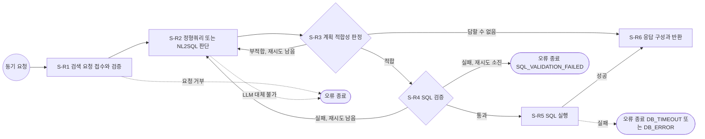

# SQL 검색기 (W-1)

상담사 질문을 받아 정형 DB(PostgreSQL)에서 답의 근거 데이터를 찾아 주는 프로그램임.  
설계 근거는 `design/sql-retriever/sql_retriever_워크플로우설계서.pptx` 한 벌뿐임.

## 1. 목표와 주요 기능
- 목표: 상담사가 통화 중에 회원 데이터 근거를 15초 안에 받아, 추측 없이 정확하게 답할 수 있게 함
- 주요 기능
  - 질문 속 전화번호, 카드번호 같은 개인 식별자를 `[가림]`으로 바꾼 뒤에만 LLM에 보냄
  - 미리 검사해 둔 정형쿼리 14개(기본 9개 + 3조 추가 5개)로 답할 수 있으면 그것을 먼저 쓰고, 아니면 LLM이 SQL을 새로 만듦(NL2SQL)
  - LLM이 만든 SQL은 검증 규칙을 통과한 뒤에만 실행함. 통과하지 못하면 1번만 다시 만들게 함
  - 실행은 읽기 전용 트랜잭션에서, 상담 중인 회원의 행만 보이게 세션 변수를 걸고 함
  - 단계마다 남은 시간을 재서, 시간이 모자라면 LLM 대신 키워드 규칙으로 정형쿼리를 고르는 등 미리 정한 길로 감
  - CLI(명령줄)와 API(HTTP) 두 가지로 실행함

### 처음 보는 분을 위한 용어 풀이
| 용어 | 한 줄 풀이 |
|------|-----------|
| NL2SQL | 사람이 쓴 질문(Natural Language)을 LLM이 DB 조회 문장(SQL)으로 바꾸는 방식 |
| 정형쿼리 | 자주 묻는 질문에 쓰려고 미리 만들어 검사까지 끝낸 고정 SQL. ID(FQ-01 ~ FQ-14)로 골라 씀 |
| 뷰(View) | 원본 표를 그대로 보여 주지 않고 필요한 컬럼과 기간만 골라 보여 주는 가상의 표 |
| 행 수준 보안(RLS) | DB가 행마다 "이 회원의 행인가"를 검사해, 지정한 회원의 행만 보이게 거르는 기능 |
| 세션 변수 | DB 접속 하나에만 잠시 붙여 두는 값. 여기서는 회원ID, 기준일, 거래 제공 시작일 |
| 최악값 | 타임아웃까지 기다리고 재시도까지 다 썼을 때 걸리는 가장 긴 시간 |
| 반복 구간(L-1) | 계획이 맞지 않거나 SQL 검증에 실패하면 S-R2로 1번 되돌아가 다시 도는 구간 |
| 착지 단계 | 시간이 모자라거나 재시도를 다 썼을 때 이어서 가는 단계 |
| 포트(Port) | 업무 코드가 "이런 기능이 필요함"이라고 정한 약속. DB나 LLM 코드는 이 약속을 따라 만듦 |

### 3조 변경(VIP 이탈 방지, 2026-10-19)
3조는 예제의 단계와 구조는 그대로 두고, 논리 뷰와 정형쿼리만 우리 고객군(VIP 이탈 방지)에 맞게 바꿨음

| 구분 | 바뀐 내용 | 파일 |
|------|----------|------|
| 허용 뷰 | 7개 → 12개(이탈 신호 뷰 5개 추가). NL2SQL이 읽을 수 있는 컬럼도 함께 추가 | `app/domain/catalog.py`, `rdb/init/07_vip_churn_views.sql` |
| 정형쿼리 | FQ-01 ~ FQ-08 → FQ-01 ~ FQ-14. 번호와 SQL은 설계서(`design/sql-retriever/work/fixed_queries.json`)를 따름 | `app/domain/fixed_queries.py` |
| 뷰별 제공 기간 | 새 뷰 5개의 제공 기간을 원천 뷰와 같게 정함 | `app/domain/periods.py` |
| 키워드 규칙 | FQ-10 ~ FQ-14 규칙 추가. "연회비", "업종"처럼 기본 규칙과 겹치는 낱말이 있어 3조 규칙을 앞에 둠 | `app/domain/fixed_queries.py` |
| LLM 프롬프트 | 시스템 프롬프트의 뷰 표와 정형쿼리 표에 새 뷰와 FQ-01 ~ FQ-14를 반영 | `app/infrastructure/prompts/c01_system_prompt.md` |

3조 추가 정형쿼리와 뷰

| ID | 묻는 내용 | 읽는 뷰 |
|----|----------|---------|
| FQ-10 | 월 사용액 추이와 전월 대비 | `app.vip_monthly_trend` |
| FQ-11 | 연회비 대비 사용액(연 환산 배수) | `app.vip_annual_fee_burden` |
| FQ-12 | 마지막 승인일과 최근 30일 활동 비교 | `app.vip_activity_signal` |
| FQ-13 | 업종별 사용액 비중과 순위(주 사용 업종) | `app.vip_category_share` |
| FQ-14 | 이탈 신호 종합(최근 3개월 변화율과 활동) | `app.vip_churn_signal_summary` |

번호가 바뀐 기존 정형쿼리: 업종별 FQ-05 → FQ-08, 최근 연체 FQ-06 → FQ-05, 연체 이력 FQ-07 → FQ-06, 일별 FQ-08 → FQ-07.
새로 생긴 FQ-09는 가맹점 이용 상위 10곳임. 예전 번호로 적힌 `work/test_report.md` 1 ~ 6절은 이 변경 전 결과임

확인한 것과 확인하지 못한 것(정직한 보고)
- 확인함: 도메인 규칙(정형쿼리 14개, 키워드 규칙 29건, 뷰 12개, 뷰별 기간)을 외부 패키지 없이 파이썬만으로 실행해 단언이 모두 맞음
- 확인하지 못함: pytest 전체(패키지 미설치), 새 뷰 5개의 DB 생성과 EXPLAIN, 통합 시험(실제 DB), LLM 호출 시험
- 새 뷰 5개의 컬럼 목록은 DB가 아니라 `07_vip_churn_views.sql`을 읽어 옮긴 값임. 팀원 PC에서 DB를 띄워 확인해야 함
- 예제 코드와 설계서가 원래 다른 부분은 3조가 고치지 않았음(예: 코드의 전체 시간 예산 15초, 설계서는 30초)

## 2. Workflow
단계ID는 설계서와 같음. 점선은 오류 종료(예외 경로)임



- 시간 예산: 전체 15초, 종료 처리 1초, 단계 시작 기준 0.75초(15초의 5%)
  - 남은 시간 = 15 - 지금까지 걸린 시간 - 1
  - 남은 시간 예산 = 남은 시간 - 앞으로 남은 LLM 호출 최악값(5초 또는 0초)
  - 남은 시간 예산이 0.75초 이상일 때만 단계를 시작함. 모자라면 단계별 착지 단계로 감(설계서 28장)

## 3. 설계서와 구현 대조
설계 항목별 전체 대조표(구현 위치와 확인한 시험)는 `work/design_trace.md`에 있음. 아래는 요약임

| 설계 항목 | 구현 위치 |
|-----------|-----------|
| S-R1 검색 요청 접수와 검증 | `app/application/steps.py` step_r1, `app/domain/request_rules.py`, `app/domain/masking.py` |
| S-R2 정형쿼리 또는 NL2SQL 판단 | `app/application/steps.py` step_r2, `app/domain/fixed_queries.py`(키워드 규칙) |
| S-R3 계획 적합성 판정 | `app/application/steps.py` step_r3, `app/domain/periods.py`(뷰별 제공 기간) |
| S-R4 SQL 검증 | `app/application/steps.py` step_r4, `app/infrastructure/sql_validator.py`, `app/domain/catalog.py` |
| S-R5 SQL 실행 | `app/application/steps.py` step_r5, `app/infrastructure/postgres_repository.py` |
| S-R6 응답 구성과 반환 | `app/application/steps.py` step_r6, `app/domain/messages.py`, `app/infrastructure/audit_log.py` |
| 흐름(분기, 반복 구간 L-1) | `app/infrastructure/graph.py`(LangGraph StateGraph), `app/application/steps.py` next_after_r3, next_after_r4 |
| C-01 LLM 커넥터 | `app/infrastructure/groq_planner.py`, `app/infrastructure/prompts/` |
| 남은 시간 예산 정책 | `app/domain/time_budget.py` |
| 오류 응답 8종 | `app/application/models.py` ERROR_CATALOG |
| 진입점 | `app/presentation/cli.py`, `app/presentation/api.py` |

## 4. 디렉토리 구조
```
retriever/sql-retriever/
├─ app/
│  ├─ domain/            업무 규칙(외부 기술 없음): 시간 예산, 요청 검사, 식별자 가림, 허용 뷰, 정형쿼리, 기간, 안내 문장
│  ├─ application/
│  │  ├─ models.py       요청, 응답, 상태, 오류 구조
│  │  ├─ ports.py        포트 6개(LLM, 회원 확인, SQL 실행, SQL 검증, 감사 로그, 흐름 실행)
│  │  ├─ steps.py        S-R1 ~ S-R6 단계 함수
│  │  └─ services.py     요청 1건 실행과 HTTP 상태 변환
│  ├─ infrastructure/    포트 구현: Groq LLM, PostgreSQL, sqlglot 검사기, LangGraph 흐름, 감사 로그, 설정
│  │  └─ prompts/        C-01 시스템 프롬프트 전문, 유저 프롬프트 틀
│  ├─ presentation/      CLI, FastAPI
│  └─ bootstrap.py       조립 지점(구현체 생성은 여기서만)
├─ tests/                단위 시험(가짜 객체)과 통합 시험(실제 DB, 실제 LLM)
├─ work/                 설계 대조표, 개발 계획, 시험 결과, 실행 로그, 설계서 장 그림
├─ logs/                 감사 로그(실행 시 생김)
├─ run_cli.py            CLI 실행 스크립트
├─ serve_api.py          API 서버 실행 스크립트
├─ pytest.ini
└─ requirements.txt
```

## 5. 가상환경 설정
Python 3.13 기준임. 명령은 모두 `retriever/sql-retriever` 폴더에서 실행함

### 5.1 Windows + Git Bash
```bash
python -m venv .venv
```
```bash
source .venv/Scripts/activate
```
```bash
pip install -r requirements.txt
```

### 5.2 Windows + PowerShell
```powershell
python -m venv .venv
```
```powershell
.\.venv\Scripts\Activate.ps1
```
```powershell
pip install -r requirements.txt
```
- 스크립트 실행이 막혀 있으면 먼저 `Set-ExecutionPolicy -Scope CurrentUser RemoteSigned` 실행

### 5.3 Mac + 터미널(zsh 또는 bash)
```bash
python3 -m venv .venv
```
```bash
source .venv/bin/activate
```
```bash
pip install -r requirements.txt
```
- Mac에서도 PowerShell(`pwsh`)을 쓰면 활성화 명령은 `./.venv/bin/Activate.ps1`임

## 6. `.env` 설정
- 위치: 저장소 루트의 `secrets/.env` (즉 `retriever/sql-retriever/../../secrets/.env`). 다른 곳이면 `SQL_RETRIEVER_ENV_FILE`에 경로를 줌
- 같은 이름이 환경변수에도 있으면 환경변수 값이 이김
- 값은 이 문서에 적지 않음. 파일은 Git에 올리지 않음(`.gitignore`가 `.env`를 막음)

| 이름 | 필수 | 설명 |
|------|------|------|
| `SQL_RETRIEVER_LLM_PROVIDER` | 필수 | LLM 제공자. 지금은 `groq`만 지원(설계서 23장) |
| `SQL_RETRIEVER_LLM_MODEL` | 필수 | 모델 ID. 설계서 값은 `openai/gpt-oss-120b` |
| `GROQ_API_KEY` | 필수 | Groq API 키 |
| `RDB_PASSWORD` | 필수 | NL2SQL 계정 `sql_retriever_user`의 비밀번호 |
| `RDB_HOST` | 선택 | DB 호스트. 기본 `localhost` |
| `RDB_PORT` | 선택 | DB 포트. 기본 `5432` |
| `RDB_NAME` | 선택 | DB 이름. 기본 `cardlab` |
| `SQL_RETRIEVER_AUDIT_LOG` | 선택 | 감사 로그 파일. 기본 `logs/audit.jsonl` |
| `SQL_RETRIEVER_ENV_FILE` | 선택 | `.env` 파일 경로. 기본 `../secrets/.env` |

- DB 계정 이름은 설정으로 바꿀 수 없게 `sql_retriever_user`로 고정함(관리자 계정 사용 방지)

## 7. 실행 방법
먼저 DB 컨테이너(`hybrid-ai-lab-rdb`)가 떠 있어야 함. 시험용 회원ID는 `rdb/README.md`의 합성 회원을 씀

### 7.1 CLI 실행
```bash
python run_cli.py --member-id M-5001 --question "보유 카드 목록 보여 주세요"
```
```bash
python run_cli.py --member-id M-5001 --question "7월에 가장 많이 쓴 가맹점 3곳 알려 주세요" --base-date 2026-08-31
```
- 응답 JSON(설계서 18장 13개 필드)을 화면에 출력함. 오류면 오류 응답(33장)을 출력하고 종료 코드 1을 돌려줌
- `--request-id`를 주지 않으면 `cli-` 로 시작하는 ID를 자동으로 만듦

### 7.2 API 서버 실행
```bash
python serve_api.py --port 8000
```
- 주소: `POST http://127.0.0.1:8000/v1/sql-retriever/search`
- API 문서 화면: `http://127.0.0.1:8000/docs`
- Windows Git Bash에서 curl 명령줄에 한글을 바로 넣으면 UTF-8이 아닌 값이 가서 400이 남. 본문을 UTF-8 파일로 만들어 보냄

요청 본문 예(`request.json`, UTF-8로 저장)
```json
{"request_id": "req-001", "question": "연체 이력 보여 주세요", "member_id": "M-4001"}
```
```bash
curl -s -H "Content-Type: application/json" --data-binary @request.json http://127.0.0.1:8000/v1/sql-retriever/search
```
PowerShell에서 보내는 예
```powershell
$body = '{"request_id":"req-001","question":"연체 이력 보여 주세요","member_id":"M-4001"}'
Invoke-RestMethod -Method Post -Uri http://127.0.0.1:8000/v1/sql-retriever/search `
  -ContentType "application/json; charset=utf-8" -Body ([System.Text.Encoding]::UTF8.GetBytes($body))
```

응답 예(정상, 일부 줄임)
```json
{"request_id": "req-001", "status": "OK", "route": "FIXED", "query_id": "FQ-06", "plan_source": "LLM",
 "columns": [{"name": "base_month", "type": "bpchar(7)"}], "rows": [{"base_month": "2025-09"}],
 "row_count": 12, "truncated": false, "base_date": "2026-08-31", "coverage_start": "2025-08-01",
 "message": "기준일 2026-08-31 기준 12건", "elapsed_ms": 1464}
```

| 결과 | HTTP 상태 |
|------|-----------|
| 정상(OK), 답할 수 없음(UNANSWERABLE) | 200 |
| INVALID_REQUEST | 400 |
| MEMBER_NOT_FOUND | 404 |
| SQL_VALIDATION_FAILED | 422 |
| DB_ERROR, INTERNAL_ERROR | 500 |
| LLM_UNAVAILABLE | 503 |
| DB_TIMEOUT, TIME_BUDGET_EXCEEDED | 504 |

### 7.3 시험 실행
단위 시험(DB와 LLM 없이 가짜 객체로 실행, 기본값)
```bash
python -m pytest
```
통합 시험(실제 DB와 실제 Groq LLM 필요, 약 3분). Groq 분당 토큰 한도 때문에 LLM 호출 사이를 20초씩 띄움
```bash
python -m pytest -m integration
```
- 통합 시험의 실측값은 `work/measurements.jsonl`에 덧붙여 기록됨
- 시험 결과 보고: `work/test_report.md`
